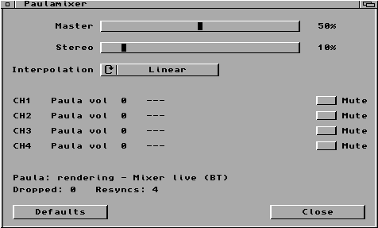

<p align="center">
  
</p>

# airpaula - AI CODED

Stream emulated Amiga Paula audio over Bluetooth Classic A2DP (SBC) using a PiStorm and the Raspberry Pi's onboard Bluetooth controller. The system runs in bare-metal Emu68. PaulaMixer provides native AmigaOS mixer controls.

**Hardware-tested configuration:** Amiga 600, PiStorm Classic, Raspberry Pi 3A+, AmigaOS 3.1. Other combinations have not been validated.

## Requirements

- Provided Emu68 1.1 kernel and `BTDiag` application.
- Provided PaulaMixer commodity if mixer controls are desired.
- Bluetooth Classic A2DP headphones or speaker.

## Installation and first pairing

1. Back up the current Emu68 boot image and the Raspberry Pi boot partition's `config.txt`. Install the provided Emu68 kernel in place of the existing one. Copy `BTDiag` to `C:`.
2. For initial discovery, use these lines in the boot partition's `config.txt` (retaining any other required settings):

   ```ini
   dtoverlay=emu68
   dtparam=args=paula_bt
   ```

3. Reboot and put the audio device in discoverable/pairing mode, then run:

   ```text
   BTDiag --scan
   ```

4. Copy the device's Bluetooth Classic address from the scan and update `config.txt`:

   ```ini
   dtoverlay=emu68
   dtparam=args=paula_bt bt_peer=88:E9:FE:8E:BC:7F
   ```

   The address above is an example; use your own device's address.
   Perform another cold boot with the device in pairing mode. Wait for A2DP audio to start.

6. Once pairing succeeds, run:

   ```text
   BTDiag --key
   ```

   Copy the **complete `dtparam=args=...` line** printed by BTDiag into `config.txt`, replacing the previous `dtparam=args` line. It includes `bt_bond=TYPE:LINK_KEY` and preserves the pairing across reboots.
   
   **Keep the Link Key private**: it is a Bluetooth bonding credential. Do not publish it in logs, screenshots, or example configurations.

## Everyday use

- Power on the paired speaker/headphones and boot the Amiga. Bluetooth reconnects automatically, including after a chord reset or speaker power cycle.
- Run `BTDiag` to inspect Bluetooth state. For working playback, look for `Reconnect: streaming`, `stream_open=1` and `started=1`.
- `BTDiag --scan` discovers devices; `BTDiag --key` displays the saved bonding configuration; `BTDiag --recover` performs a **Bluetooth-only rebootstrap** after the WiFiPi initialization race. Do not invoke `--recover` repeatedly while Bluetooth is healthy.

## wifipi.device (non) compatibility!

On the tested Raspberry Pi 3A+, bringing WiFiPi online **after** Bluetooth can reset the shared wireless chip and interrupt audio. The workaround is to run `BTDiag --recover` **once, after WiFiPi has initialized**. This restores A2DP without resetting the Raspberry Pi, disconnecting Wi-Fi, or modifying WiFiPi.device.

As an alternative workaround, the standalone token `pause` in `cmdline.txt` delays Bluetooth startup by about 60 seconds, allowing going ONLINE before establishing the audio path.

## PaulaMixer Commodity

<p align="center">
  
</p>

Copy the matching `PaulaMixer` executable and `PaulaMixer.info` to the same directory. For automatic startup, place PaulaMixer in `SYS:WBStartup` with its `.info` icon and configure ToolTypes in Workbench **Information**:

```ini
DONOTWAIT
CX_POPUP=NO
CX_PRIORITY=0
CX_POPKEY=rawkey control alt p
MASTER=50
STEREO=10
INTERPOLATION=LINEAR
MUTE0=NO
MUTE1=NO
MUTE2=NO
MUTE3=NO
```

`CX_POPUP=NO` starts PaulaMixer silently as a Commodity; show its GUI through Commodities Exchange or the configured hotkey. `CX_POPUP=YES` opens the window at startup. `MASTER` and `STEREO` accept values from 0 to 100. `INTERPOLATION` accepts `LINEAR` or `NEAREST`. Closing the GUI leaves the Commodity running.

To apply settings once from Shell without keeping a resident Commodity:

```text
PaulaMixer ONESHOT=YES MASTER=80
```

## Boot configuration notes

- **PAL is the default.** Do not append `bt_paula_clock=pal` to the already long `dtparam=args` line.
- For NTSC, add `bt_paula_clock=ntsc` to the existing single line in `cmdline.txt`.

## Credits

AirPaula builds on the work of three projects:

1. **Paula 8364 Emulator** — by **Andreas Wendorf (Akustikrausch)**. The clean-room Paula audio emulator is used with bare-metal adaptations for Emu68. Original project: [amiga-paula-8364-emulator](https://github.com/akustikrausch/amiga-paula-8364-emulator). Licensed under the MIT License; the copyright notice is preserved in `src/raspi/paula/LICENSE`.
2. **BTstack** — by **BlueKitchen GmbH**. Provides the Bluetooth Classic host stack, A2DP, AVDTP, L2CAP, authentication, and SBC support. Original project: [bluekitchen/btstack](https://github.com/bluekitchen/btstack). BTstack is free for non-commercial use under its own license; commercial use requires a separate arrangement with BlueKitchen.
3. **Emu68** — by **Michal Schulz**. The ARM-based Motorola 68k emulation environment and bare-metal foundation on which AirPaula runs. Original project: [michalsc/Emu68](https://github.com/michalsc/Emu68).

AirPaula adds the PiStorm-specific Paula capture path, Bluetooth HCI integration, A2DP streaming, diagnostic and recovery tools, and the PaulaMixer AmigaOS Commodity. Thanks to the original authors and contributors of all three projects.

